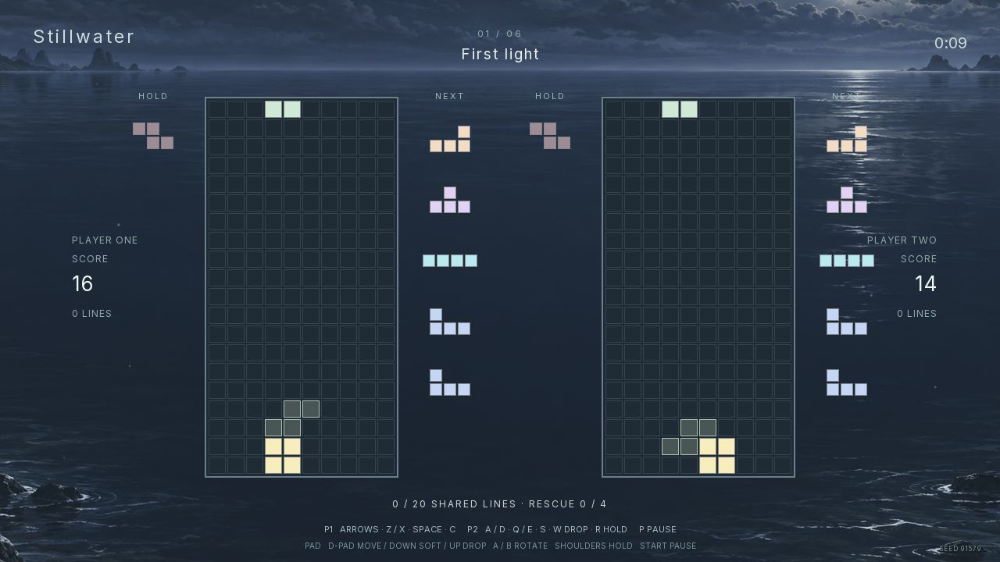

# Stillwater

A falling-block game authored in Chibi. Three original ocean paintings and three music arrangements accompany a six-chapter journey. Play alone or share a journey with someone beside you.



- Journey unlocks six chapters, twelve lines each. Choose an unlocked starting chapter on the title screen.
- Endless increases the falling speed as you clear lines.
- Forty lines uses the same seed every time and saves your fastest finish.
- Duet gives each player a board and a shared twenty-line chapter goal. Four cleared lines rescue a partner; the reserve holds eight charges.

The rules include seven-piece bags, SRS quarter turns, hold, five previews, a ghost, soft and hard drops, a 500 ms lock delay, fifteen lock resets, T-spins, combos, and back-to-back bonuses. Settings cover audio, movement repeat, effects, reduced motion, and the ghost. Progress and settings save locally.

## Play

[Play Stillwater in your browser](https://waldnercharles.github.io/chibi-tetris/).

The native export is `dist/Stillwater.app` on macOS. Open it normally. The local browser export is `dist/web`; serve it with `make serve`, then open [the local game](http://127.0.0.1:18769). Exports are generated locally and kept out of the source branch.

| Action | Player one | Player two | Controller |
| --- | --- | --- | --- |
| Move | Left / right | A / D | D-pad or left stick |
| Soft drop | Down | S | Down |
| Hard drop | Space | W | D-pad up |
| Clockwise | Up / X | E | A |
| Counterclockwise | Z | Q | B |
| Hold | C / Shift | R | Either shoulder |
| Pause | P | P | Start |

Menus use arrows and Enter, or controller 1's D-pad and A. Backspace or B returns. Mouse buttons work too. In Duet, controller 1 shares the left board with player one's keyboard keys and controller 2 shares the right board with player two's keys. Disconnecting a controller pauses play. Reconnect and confirm, or press Enter to use the keyboard.

## Build from source

This game consumes the Chibi SDK. KDL owns composition, `.chibi` owns all executable game rules, and RML/RCSS owns the UI. There is no game-specific native module or separate browser implementation.

The exact engine commit and package identities are recorded in `toolchain.json`. Check out that engine commit in `.chibi/engine`, or pass `ENGINE=/absolute/path/to/that/checkout` to Make. The engine's documented CMake, C compiler, libclang and platform dependencies are required. Browser packaging also requires Emscripten.

```sh
git clone --no-checkout https://github.com/waldnercharles/chibi.git .chibi/engine
git -C .chibi/engine checkout "$(python3 -c 'import json; print(json.load(open("toolchain.json"))["engine"]["revision"])')"
make sdk
make authoring
make play
make native
make web-player
make web
```

`SDK`, `CTL`, `ENGINE_BUILD`, and `WEB_PLAYER` can select existing matching installations. SDK and build output live under ignored `.chibi/`, `build/`, or `dist/` directories. Native exports include the player, prepared game, resources, and dependency licenses. Browser exports use Chibi's WebGPU player with its WebGL 2 fallback.

## Publish to GitHub Pages

GitHub Pages serves the root of the `gh-pages` branch. Build the browser export with the pinned toolchain, run the focused checks, and inspect browser play before publishing. Keep the SDK dependency notices in the export. Source changes on `main` need a new export and publishing commit to reach the website.

From a clean, committed source checkout, publish an updated export with:

```sh
make web
git clone --single-branch --branch gh-pages https://github.com/waldnercharles/chibi-tetris.git build/pages-publish
rsync -a --delete --exclude=.git dist/web/ build/pages-publish/
touch build/pages-publish/.nojekyll
cp LICENSES.md build/pages-publish/
git -C build/pages-publish add --all
git -C build/pages-publish commit -m "Publish Stillwater from $(git rev-parse --short HEAD)"
git -C build/pages-publish push origin gh-pages
rm -rf build/pages-publish
```

Wait for the repository's Pages deployment to finish, then verify the public play link above. The publishing directory is temporary; remove it before repeating these steps.

## Verify and edit

```sh
make format
make validate
make test
```

The C/pico_unit dispatcher calls the real authored libraries and behaviors through the controller. It covers deterministic rules, both keyboard and controller slots, lock/reset/hold behavior, topout/rescue, Journey and Sprint completion, cooperative progression, disconnect pause, and save readback. It runs under the engine's single 60-second production supervisor. Configuration and compilation are separate from that deadline.

`content/behaviors/Board.chibi` handles each board, `content/libraries/Pieces.chibi` and `Rules.chibi` own piece geometry and rule calculations, and `Shell.chibi` owns menus and progression. `Environment.chibi` only drives a fixed pool of visual entities. Test-only fixtures stay in `tests/fixtures` and are never exported.

Read [validation](docs/validation.md) for executed checks and limits, [rules](docs/rules.md) for scoring, [audio](docs/audio.md) and [visuals](docs/visuals.md) for asset provenance, and [licenses](LICENSES.md) for terms.
