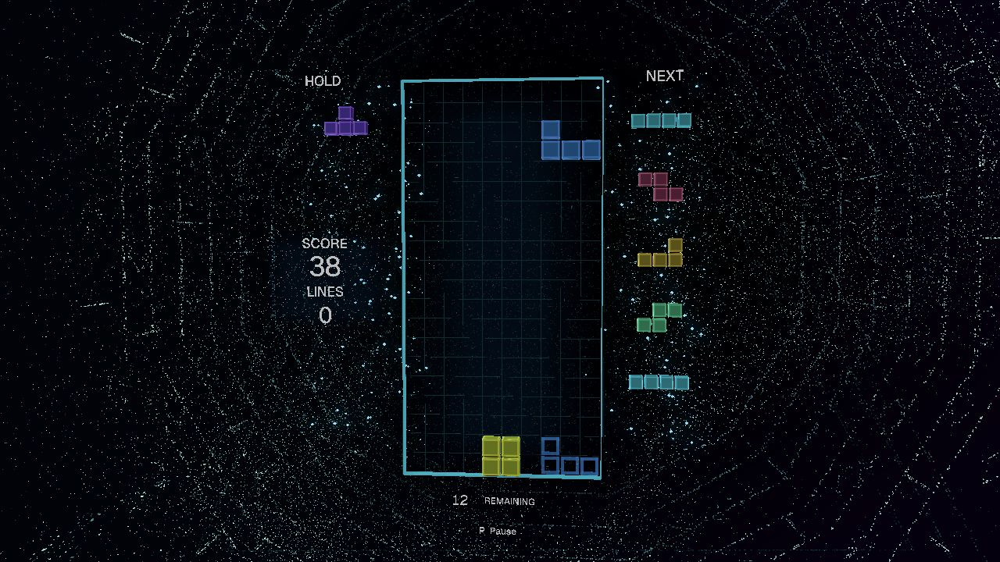

# Stillwater

A falling-block game authored in Chibi. A six-chapter journey unfolds through cyan streams, ivory orbits, amber geometry and teal currents. Light and motion respond to the music and your play. Play alone or share a journey with someone beside you.



- Journey starts at your highest unlocked chapter after you choose music. Each of its six chapters takes twelve lines.
- Endless increases the falling speed as you clear lines.
- Forty lines uses the same seed every time and displays your elapsed time and saved fastest finish.
- Duet gives each player a board and a shared twenty-line chapter goal. Four cleared lines rescue a partner; the reserve holds eight charges.

The rules include seven-piece bags, SRS quarter turns, hold, five previews, a ghost, soft and hard drops, a 500 ms lock delay, fifteen lock resets, T-spins, combos, and back-to-back bonuses. Progress, best results, volume, effects, reduced motion and the ghost setting save locally.

## Play

[Published browser release](https://waldnercharles.github.io/chibi-tetris/).

The native export is `dist/Stillwater.app` on macOS. Open it normally. The local browser export is `dist/web`; serve it with `make serve`, then open [the local game](http://127.0.0.1:18769). Exports are generated locally and kept out of the source branch.

| Action | Player one | Player two | Controller |
| --- | --- | --- | --- |
| Move | Left / right | A / D | D-pad or left stick |
| Soft drop | Down | S | Down |
| Hard drop | Space | W | D-pad up |
| Clockwise | Up / X | E | A |
| Counterclockwise | Z | Q | B |
| Hold | C / Shift | R | Either shoulder |
| Pause | P | P | Start |

A live demonstration plays beside the opening controls. Choose a mode with **1–4** or its button. Expand **Options** for particle density, motion, ghost and volume. Press **M Connect audio** to share music already playing in another tab, then select the music tab and enable audio in the browser's picker. Connection leaves you on this screen. **Enter Play** keeps a connected source, or uses the bundled score when no source is ready. Play clears the demonstration, centers the camera and reveals a fresh board. Browser and operating-system capture support varies; there is no service account sign-in inside the game.

These controls work inside the scene:

| Action | Key |
| --- | --- |
| Select a mode before Play; start Journey / Endless / Forty lines / Duet during play | 1 / 2 / 3 / 4 |
| Pause or resume | P |
| Resume when paused, restart after a result | Enter |
| Restart the same run while paused or after a result | Backspace |
| Previous / next unlocked Journey chapter while paused or after a result | 7 / 8 |
| Connect or reconnect audio while preserving the run | M |
| Cycle effect density | V |
| Toggle reduced motion | F |
| Toggle the ghost | G |
| Lower / raise master volume | 9 / 0 |

Controller 1's A confirms resume or restart; B restarts while paused or after a result. In Duet, controller 1 shares the left board with player one's keyboard keys and controller 2 shares the right board with player two's keys. Either controller's Start pauses or resumes. Disconnecting a controller pauses play. Reconnect and confirm, or press Enter to continue with the keyboard.

Chapter selection starts a fresh run at the selected chapter and stays paused. Press Enter when ready. The chapter keys stop at the first and highest unlocked chapters. New games release the old blocks outward before the fresh board appears. Earning a Journey chapter preserves your pile through a brief camera passage; reduced motion skips it.

External music uses browser audio sharing or a native loopback device. Press M to connect directly to an audio source. The scene responds to its measured sound. See [audio capture](docs/audio.md#music-reaction-and-capture) for setup.

## Build from source

This game consumes the Chibi SDK. KDL owns scene composition and material graphs, `.chibi` owns game rules and presentation, and ordinary GLSL files in `content/shaders` own particle motion and appearance. Blocks, scenery and text use the 3D renderer. There is no game-specific native module or separate browser implementation.

The exact engine commit and package identities are recorded in `toolchain.json`. This development revision uses the engine branch `cwaldner/stillwater-3d-sdk`. Use its existing checkout through `.chibi/engine`, or pass `ENGINE=/absolute/path/to/that/checkout` to Make. The engine's documented CMake, C compiler, libclang and platform dependencies are required. Browser packaging also requires Emscripten.

```sh
git clone --no-checkout https://github.com/waldnercharles/chibi.git .chibi/engine
git -C .chibi/engine checkout "$(python3 -c 'import json; print(json.load(open("toolchain.json"))["engine"]["revision"])')"
make sdk
make authoring
make play
make native
make web-player
make web
```

`SDK`, `CTL`, `ENGINE_BUILD`, and `WEB_PLAYER` can select existing matching installations. SDK and build output live under ignored `.chibi/`, `build/`, or `dist/` directories. Native exports include the player, prepared game, resources, and dependency licenses. Browser exports use Chibi's WebGPU player with its WebGL 2 fallback.

## Publish to GitHub Pages

Every completed game iteration is published to the same public play URL. GitHub Pages automatically deploys the root of `gh-pages` after publication. Run the focused checks and inspect browser play with the pinned toolchain before publishing.

Commit and push the tested source branch. If the engine pin changed, push its source branch too. Then publish from the clean source checkout (requires Git, GitHub CLI, jq, curl, rsync and shasum):

```sh
git push -u origin HEAD
make publish
```

`make publish` checks the remote source revision and pinned SDK/player, exports the game, preserves dependency licenses, writes `deployment.json` and `SHA256SUMS`, and pushes the export. It removes its temporary checkout on exit. The companion editor under `/dev/` is preserved while its separate workflow refreshes it for the new game revision. Source pushes alone do not update the game.

Wait for the repository's Pages deployment to finish. `make verify-published` uses the engine's 60-second production supervisor to compare the public revision, checksum manifest, game and player assets with the published branch. Then open the public URL and check music selection, movement/drop and Duet play in a bounded browser session. Publication is complete only after those checks pass.

## Verify and edit

```sh
make format
make validate
make test
```

The C/pico_unit dispatcher calls the real authored libraries and behaviors through the controller. It covers deterministic rules, both keyboard and controller slots, lock/reset/hold behavior, topout/rescue, Journey and Sprint completion, cooperative progression, disconnect pause, save readback, the music gate, controlled soft drop, piece-surface reactions, scene transitions and the 3D environment's effect controls. It runs under the engine's single 60-second production supervisor. Configuration and compilation are separate from that deadline.

`content/behaviors/Board.chibi` handles each board, `content/libraries/Pieces.chibi` and `Rules.chibi` own piece geometry and rule calculations, and `Shell.chibi` owns progression and in-game controls. `StageDirector.chibi` transitions between four particle flow regimes, block finishes and their lighting. `Environment.chibi` drives two GPU particle fields and fixed pools of reaction geometry and lights. Ordinary GLSL in `content/shaders` defines persistent particle advection, birth and appearance; the main cloud retains its position, velocity and age on the GPU. `AudioReactive.chibi` reads measured audio, `MusicResponse.chibi` adapts its levels and estimates tempo, and `Hud.chibi` places mesh text. Test-only fixtures stay in `tests/fixtures` and are never exported.

Read [validation](docs/validation.md) for executed checks and limits, [rules](docs/rules.md) for scoring, [audio](docs/audio.md) and [visuals](docs/visuals.md) for asset provenance, and [licenses](LICENSES.md) for terms.
