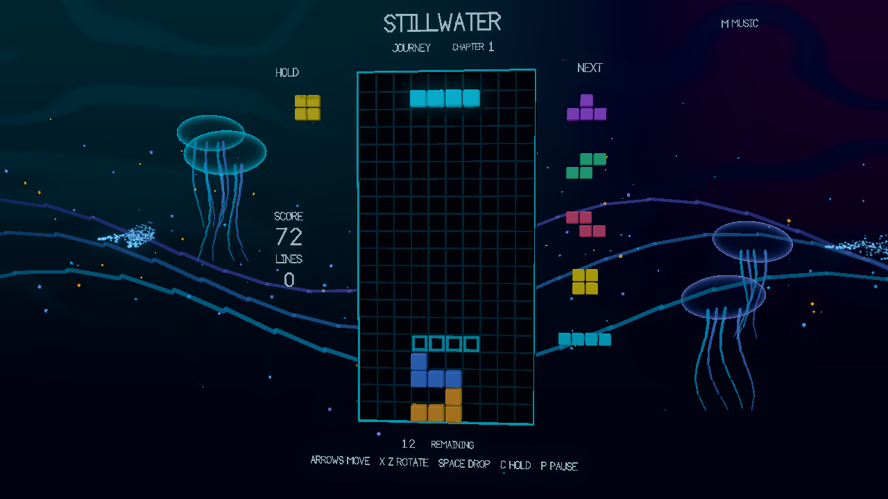

# Stillwater

A falling-block game authored in Chibi. A six-chapter journey moves through 3D ocean currents, jellyfish, auroras and stellar orbits. Light and motion respond to the music and your play. Play alone or share a journey with someone beside you.



- Journey starts immediately at your highest unlocked chapter. Each of its six chapters takes twelve lines.
- Endless increases the falling speed as you clear lines.
- Forty lines uses the same seed every time and displays your elapsed time and saved fastest finish.
- Duet gives each player a board and a shared twenty-line chapter goal. Four cleared lines rescue a partner; the reserve holds eight charges.

The rules include seven-piece bags, SRS quarter turns, hold, five previews, a ghost, soft and hard drops, a 500 ms lock delay, fifteen lock resets, T-spins, combos, and back-to-back bonuses. Progress, best results, volume, effects, reduced motion and the ghost setting save locally.

## Play

[Published browser release](https://waldnercharles.github.io/chibi-tetris/).

The native export is `dist/Stillwater.app` on macOS. Open it normally. The local browser export is `dist/web`; serve it with `make serve`, then open [the local game](http://127.0.0.1:18769). Exports are generated locally and kept out of the source branch.

| Action | Player one | Player two | Controller |
| --- | --- | --- | --- |
| Move | Left / right | A / D | D-pad or left stick |
| Soft drop | Down | S | Down |
| Hard drop | Space | W | D-pad up |
| Clockwise | Up / X | E | A |
| Counterclockwise | Z | Q | B |
| Hold | C / Shift | R | Either shoulder |
| Pause | P | P | Start |

The game opens directly into play. These controls work inside the scene:

| Action | Key |
| --- | --- |
| Start Journey / Endless / Forty lines / Duet | 1 / 2 / 3 / 4 |
| Pause or resume | P |
| Resume when paused, restart after a result | Enter |
| Restart the same run while paused or after a result | Backspace |
| Previous / next unlocked Journey chapter while paused or after a result | 7 / 8 |
| Switch between the score and external music | M |
| Cycle effect density | V |
| Toggle reduced motion | F |
| Toggle the ghost | G |
| Lower / raise master volume | 9 / 0 |

Controller 1's A confirms resume or restart; B restarts while paused or after a result. In Duet, controller 1 shares the left board with player one's keyboard keys and controller 2 shares the right board with player two's keys. Either controller's Start pauses or resumes. Disconnecting a controller pauses play. Reconnect and confirm, or press Enter to continue with the keyboard.

Chapter selection starts a fresh run at the selected chapter and stays paused. Press Enter when ready. The chapter keys stop at the first and highest unlocked chapters.

External music uses browser audio sharing or a native loopback device. Press M, choose or route the audio source, and the scene responds to its measured sound. See [audio capture](docs/audio.md#music-reaction-and-capture) for setup.

## Build from source

This game consumes the Chibi SDK. KDL owns scene composition and `.chibi` owns the game rules and presentation. Blocks, scenery and text use the 3D renderer. There is no game-specific native module or separate browser implementation.

The exact engine commit and package identities are recorded in `toolchain.json`. This development revision uses the local engine branch `cwaldner/stillwater-3d-sdk`; publish that engine commit before reproducing it from the remote clone below. Use its existing checkout through `.chibi/engine`, or pass `ENGINE=/absolute/path/to/that/checkout` to Make. The engine's documented CMake, C compiler, libclang and platform dependencies are required. Browser packaging also requires Emscripten.

```sh
git clone --no-checkout https://github.com/waldnercharles/chibi.git .chibi/engine
git -C .chibi/engine checkout "$(python3 -c 'import json; print(json.load(open("toolchain.json"))["engine"]["revision"])')"
make sdk
make authoring
make play
make native
make web-player
make web
```

`SDK`, `CTL`, `ENGINE_BUILD`, and `WEB_PLAYER` can select existing matching installations. SDK and build output live under ignored `.chibi/`, `build/`, or `dist/` directories. Native exports include the player, prepared game, resources, and dependency licenses. Browser exports use Chibi's WebGPU player with its WebGL 2 fallback.

## Publish to GitHub Pages

GitHub Pages serves the root of the `gh-pages` branch. Build the browser export with the pinned toolchain, run the focused checks, and inspect browser play before publishing. Keep the SDK dependency notices in the export. Source changes on `main` need a new export and publishing commit to reach the website.

From a clean, committed source checkout, publish an updated export with:

```sh
make web
git clone --single-branch --branch gh-pages https://github.com/waldnercharles/chibi-tetris.git build/pages-publish
rsync -a --delete --exclude=.git dist/web/ build/pages-publish/
touch build/pages-publish/.nojekyll
cp LICENSES.md build/pages-publish/
git -C build/pages-publish add --all
git -C build/pages-publish commit -m "Publish Stillwater from $(git rev-parse --short HEAD)"
git -C build/pages-publish push origin gh-pages
rm -rf build/pages-publish
```

Wait for the repository's Pages deployment to finish, then verify the public play link above. The publishing directory is temporary; remove it before repeating these steps.

## Verify and edit

```sh
make format
make validate
make test
```

The C/pico_unit dispatcher calls the real authored libraries and behaviors through the controller. It covers deterministic rules, both keyboard and controller slots, lock/reset/hold behavior, topout/rescue, Journey and Sprint completion, cooperative progression, disconnect pause, save readback, direct launch and the 3D environment's effect controls. It runs under the engine's single 60-second production supervisor. Configuration and compilation are separate from that deadline.

`content/behaviors/Board.chibi` handles each board, `content/libraries/Pieces.chibi` and `Rules.chibi` own piece geometry and rule calculations, and `Shell.chibi` owns progression and in-game controls. `Environment.chibi` and `OceanLife.chibi` drive fixed pools of 3D scenery. `AudioReactive.chibi` maps measured audio into the scene, and `Hud.chibi` places mesh text. Test-only fixtures stay in `tests/fixtures` and are never exported.

Read [validation](docs/validation.md) for executed checks and limits, [rules](docs/rules.md) for scoring, [audio](docs/audio.md) and [visuals](docs/visuals.md) for asset provenance, and [licenses](LICENSES.md) for terms.
